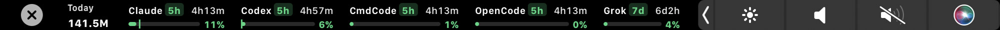
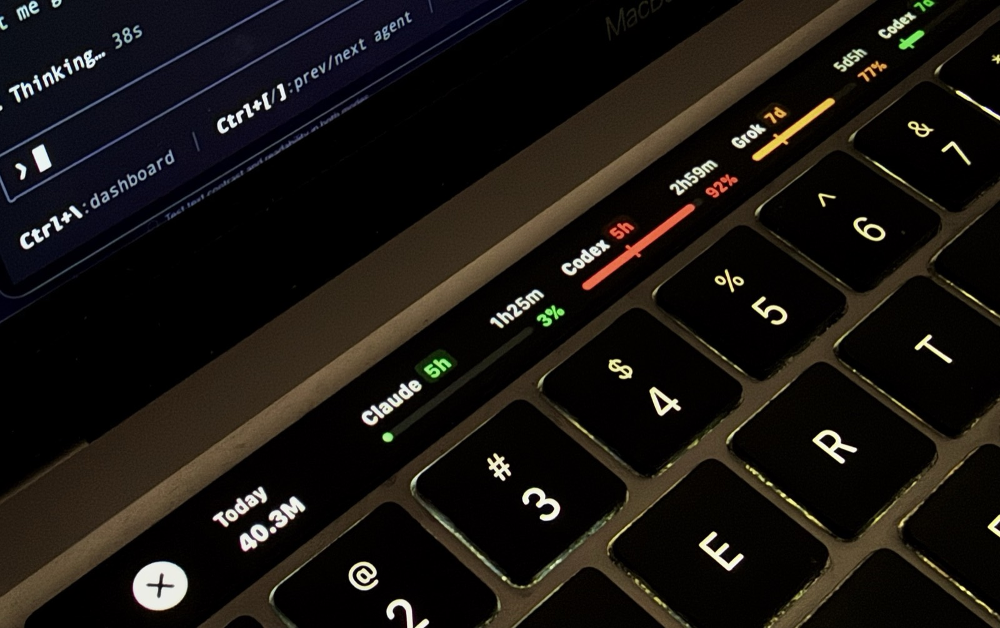
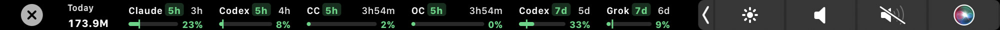

<p align="center">
  
</p>

**AI quota on the MacBook Touch Bar**

TokenBar is a free, open-source app. It keeps Claude, Codex, Cursor, Grok, OpenCode, and Command Code on the Touch Bar, with the time left on each window.

<p align="center">
  
</p>

[Download](https://github.com/jashjacob/TokenBar/releases/latest) | [Site](https://jashjacob.github.io/TokenBar) | [Changelog](https://github.com/jashjacob/TokenBar/releases)

## How to install

A MacBook with a Touch Bar, on macOS 13 or later.

[TokenTracker](https://github.com/xiufengsun/TokenTracker) has to be installed and running. TokenBar reads the quotas from it.

1. Download the latest disk image from the [releases page](https://github.com/jashjacob/TokenBar/releases/latest).
2. Open the image and drag TokenBar into `/Applications`.
3. Open TokenBar. The app is not notarized, so the first launch is a Control-click: in Applications, Control-click TokenBar and choose Open.

## Usage

1. Open TokenBar.
2. A small face shows in the menu bar. The quotas are on the Touch Bar.
3. Click the face for the menu. A checkmark puts that chip on the bar. Uncheck it to take the chip off.

The strip steps aside when you move to another app. **Pin Touch Bar**, in the menu, keeps it up.

<p align="center">
  
</p>
<p align="center"><sub>On a MacBook Pro with a Touch Bar</sub></p>

## The bar

##### Chips

Each chip is one window. You get the name, a tag such as `5h` or `7d`, the time until that window resets, and a line for how full it is. Today, on the left, is how many tokens this Mac has used since midnight.

The chip you were just using sits at the left.

<p align="center">
  
</p>

##### Green, amber, red

The line stays green while a window is quiet, turns amber as it fills, and turns red when that window is close to used up.

##### A sentence across the bar

Now and then one sentence takes the whole strip.

Amber, when a window is going fast:

> Claude 5h is burning fast. At this pace it runs out in 24m (91% used).

Pink, when a week or a month still has some left:

> Grok 7d has 14% left. It resets in 1h 45m.

Green, when a window comes back:

> OpenCode 5h reset. Now it’s 0%.

##### Tap a chip

A tap opens that tool on the Mac. Today opens TokenTracker. Sliding a finger only scrolls the strip.

## The menu

The face in the menu bar is the control for the strip.

- Each chip has a checkmark. Checked means it is on the bar. **Show All** and **Hide All** sit under the list.
- **Pin Touch Bar** keeps the strip up.
- **Refresh** asks TokenTracker again.
- **Open TokenTracker Limits** opens TokenTracker.
- **Insights…** draws those chips over the last day, or the last week.
- **Settings…** has Launch at Login, the Touch Bar, and what happens when one tool’s windows are missing.
- **Quit TokenBar**.

## How to uninstall

1. Quit TokenBar.
2. Move TokenBar from `/Applications` to the Trash.

## Build it yourself

```bash
git clone https://github.com/jashjacob/TokenBar.git
cd TokenBar
./scripts/install.sh
```

To update a copy you built this way, `git pull`, then run `./scripts/install.sh` again.

## License

MIT. [Built by Jash Jacob](https://jashjacob.com).
