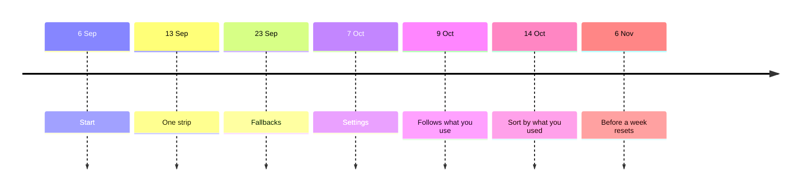

# TokenBar

See the quota before it runs out. Claude, Codex, Cursor, Grok, OpenCode, and Command Code, counting down on the Touch Bar.

<p align="center">
  
</p>
<p align="center">
  
</p>
<p align="center"><sub>On a MacBook Pro with a Touch Bar</sub></p>

Site: [jashjacob.github.io/TokenBar](https://jashjacob.github.io/TokenBar)

## Install

A Touch Bar Mac, macOS 13 or later. You don’t need the Xcode app.

```bash
git clone https://github.com/jashjacob/TokenBar.git
cd TokenBar
./scripts/install.sh
```

psst, make sure you have [TokenTracker](https://github.com/xiufengsun/TokenTracker) installed.

To update later: `git pull`, then `./scripts/install.sh` again.

## Fallbacks

TokenTracker sometimes comes back stale or empty. With **Use fallbacks** on in Settings, TokenBar asks that tool itself, using the login already on the Mac. The fallback owns every window for that tool. It checks again after five minutes, not on every poll.

| Tool | Fallback |
|---|---|
| Command Code | In |
| OpenCode | In |
| Grok | In |
| Cursor | In |
| Kimi | In |
| Claude | In |
| ChatGPT / Codex | In |
| Antigravity | In |

## Before a week resets

A soft pink line crosses the bar when a weekly window is about to reset and some of it is still unused. It speaks once for that reset. Five-hour chips stay quiet.

Grok 7d speaks in the last two hours when 10% or more is left. It also speaks in the last day when 20% or more is left, and then it does not speak again for that reset.

The same last-day line, when 20% or more is left:

- GrokBot
- Claude 7d
- Opus 7d
- Codex 7d
- Kimi 7d
- AG Cl 7d
- Gm 7d
- OpenCode wk
- CmdCode wk

Monthly chips stay quiet. The line reads like “Claude 7d still has 36% left, and it resets in 22h.”

## Along the way

Every build is on the [releases page](https://github.com/jashjacob/TokenBar/releases).



## For coding agents

Don’t download the DMG. Don’t clone TokenTracker unless asked, and don’t copy it into this repo. Keep the ad-hoc signature.

1. Touch Bar Mac, macOS 13+.
2. TokenTracker must return `200` from `http://127.0.0.1:7680/functions/tokentracker-usage-limits` before you install TokenBar.
3. `./scripts/install.sh`
4. Check `pgrep -x TokenBar` and `~/Library/Logs/TokenBar.log`.

Chip layout lives in `TouchBarStripView.swift` and `ChipLayout.swift`. Stay inside the strip (`clipsToBounds`).

## License

MIT. [Built by Jash Jacob](https://jashjacob.com).
