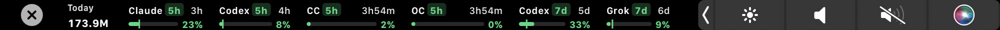
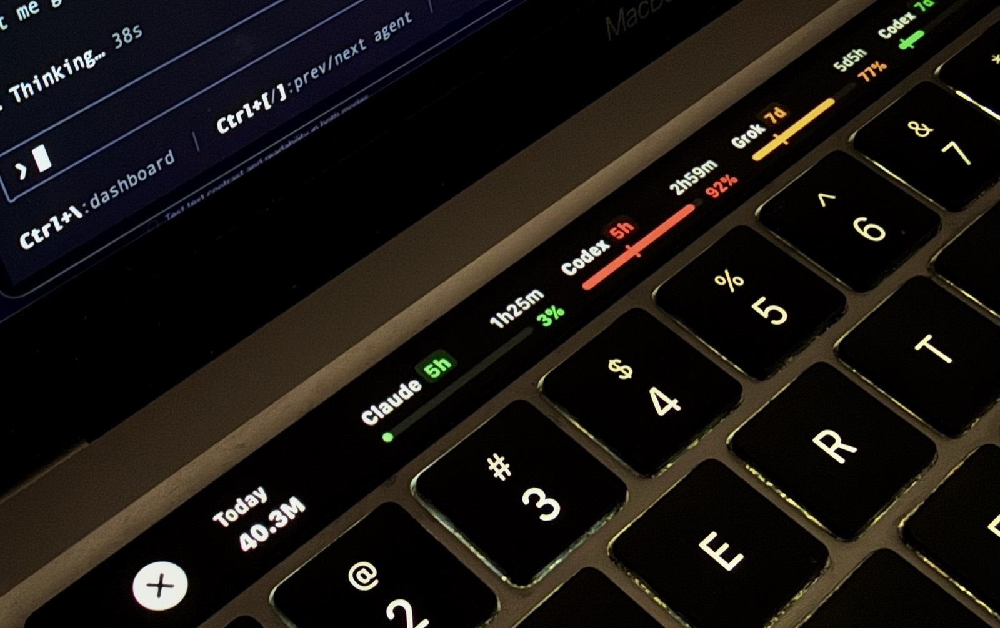
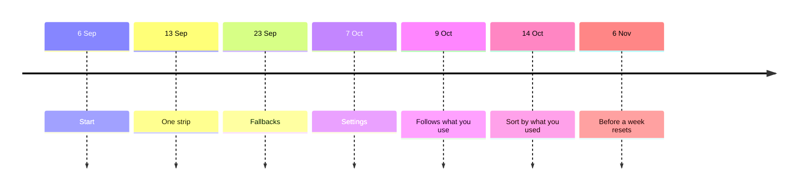

# TokenBar

See the quota before it runs out. Claude, Codex, Cursor, Grok, OpenCode, and Command Code, counting down on the Touch Bar.

The chip you were just using sits first. Green, then amber, then red. Now and then a sentence runs across the whole bar. Amber if a window is going fast. Pink if a week or a month still has some left.

<p align="center">
  
</p>
<p align="center">
  
</p>
<p align="center"><sub>On a MacBook Pro with a Touch Bar</sub></p>

Site: [jashjacob.github.io/TokenBar](https://jashjacob.github.io/TokenBar)

## Install

A Touch Bar Mac, macOS 13 or later. You don’t need the Xcode app.

```bash
git clone https://github.com/jashjacob/TokenBar.git
cd TokenBar
./scripts/install.sh
```

psst, make sure you have [TokenTracker](https://github.com/xiufengsun/TokenTracker) installed.

To update later: `git pull`, then `./scripts/install.sh` again.

## If TokenTracker comes back empty

Command Code, OpenCode, Grok, Cursor, Kimi, Claude, Codex, and Antigravity can still show, from the login already on your Mac.

## A line across the bar

Amber: “Claude 5h is burning fast. At this pace it runs out in 24m (91% used).”

Pink: “Grok 7d still has 14% left, and it resets in 1h 45m.”

## Along the way

Every build is on the [releases page](https://github.com/jashjacob/TokenBar/releases).



## License

MIT. [Built by Jash Jacob](https://jashjacob.com).
